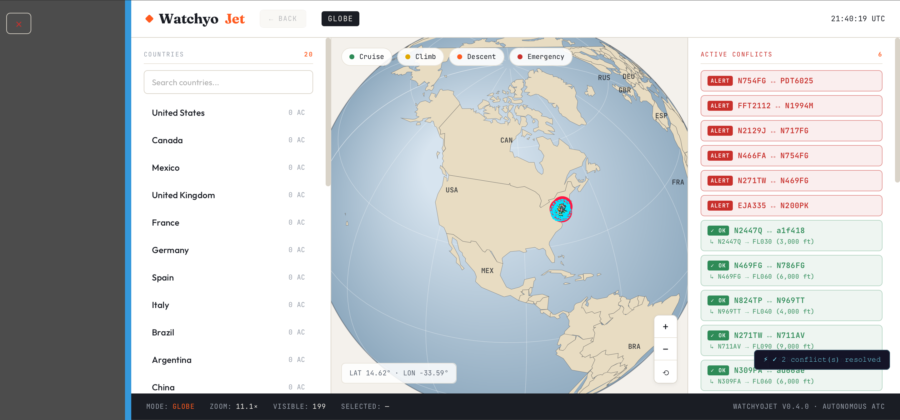

# WatchyoJet ATC

[](https://github.com/malikcodeseverything/Watchyojet-atc/actions/workflows/build.yml)

WatchyoJet ATC is a Java desktop simulator for air traffic conflict detection
and resolution around Philadelphia. It predicts where two aircraft will come
closest, groups related conflicts, and tests simulated changes in altitude,
track, or speed.



## Download

Ready-to-run builds for macOS (Apple Silicon), Windows, and Linux are on the
[Releases page](https://github.com/malikcodeseverything/Watchyojet-atc/releases/latest).
Each one bundles its own Java runtime, so nothing else needs to be installed.

| Platform | File | Start it with |
| --- | --- | --- |
| macOS | `WatchyoJet-macos-arm64.zip` | `WatchyoJet.app` |
| Windows | `WatchyoJet-windows-x64.zip` | `WatchyoJet\WatchyoJet.exe` |
| Linux | `WatchyoJet-linux-x64.tar.gz` | `WatchyoJet/bin/WatchyoJet` |

The builds are not code-signed. On macOS, right-click the app and choose
**Open** the first time, or run `xattr -dr com.apple.quarantine WatchyoJet.app`.
On Windows, choose **More info → Run anyway** if SmartScreen warns. The app
starts on live traffic; pick **Simulation → Offline demo** for the scripted
scenario.

## Run from source

Install a full JDK 21 or newer and Maven 3.8 or newer. Maven downloads the
JavaFX and Jackson dependencies on the first build.

```bash
git clone https://github.com/malikcodeseverything/Watchyojet-atc.git
cd Watchyojet-atc
mvn javafx:run -Dwatchyojet.demo=true
```

The map opens on Philadelphia. The scripted scenario starts with ten aircraft
and three predicted conflict pairs. Open the conflict panel and resolution history to follow the encounters.
The conflicts are visible for eight seconds before the simulator tries its
maneuvers. Use **Simulation → Replay demo** to restart, or wait for the
automatic one-minute reset. Demo traffic runs without an OpenSky account
or a live feed.

Live traffic is the default when you launch with `mvn javafx:run`. You can
switch modes in the app under **Simulation → Live traffic** or **Simulation →
Offline demo**. If OpenSky is temporarily unavailable, the app labels cached
tracks and falls back to scripted traffic when the cache expires. It returns
to OpenSky automatically when requests succeed again. Live coverage and
request quotas depend on OpenSky.

### Optional: an OpenSky account for longer live sessions

Without an account, OpenSky allows 400 API credits a day, so the app polls
every 20 seconds, which lasts a little over two hours of live traffic. A free
account allows 4,000 credits a day, and the app then polls every 12 seconds.
Create an API client on your OpenSky account page and pass its credentials
through the environment:

```bash
export OPENSKY_CLIENT_ID=your-client-id
export OPENSKY_CLIENT_SECRET=your-client-secret
mvn javafx:run
```

The app signs in with the OAuth2 client credentials flow, renews the token
before it expires, and logs the credits left after each refresh. Credentials
are never written to logs.

## How it works

```text
OpenSky or demo fixture
        ↓
AircraftManager
        ↓
Movement → closest point of approach → maneuver search → conflict recheck
        ↓
JavaFX controller → WebView traffic display
```

The simulator uses 3 NM laterally in the terminal area around PHL (below
FL180, within 40 NM) and 5 NM elsewhere, with 1,000 ft vertically. Terminal rules apply around every
approach-control airport the query box covers (PHL, EWR, ACY, ABE, BWI). It
predicts with each aircraft's climb or descent rate, looks 2 minutes ahead in
the terminal area and 5 minutes elsewhere, treats VFR traffic (code 1200) and
helicopters as traffic advisories rather than conflicts, and never moves an aircraft
squawking an emergency code. Pairs with both aircraft inside tower airspace
(within 5 NM of one of 15 towered airports in the query box and below 2,500 ft)
are left to the tower, the way terminal radar systems inhibit alerts near
runways. Elsewhere, pairs with an aircraft below 1,000 ft or slower than 40 kt
are reported as traffic advisories, not dropped. Because OpenSky does not
report flight rules, slow US-registered aircraft below 10,000 ft are estimated
to be VFR and get traffic advisories too. Each group of related conflicts gets
its own trial: proposed maneuvers are tested on copies of the tracks, and a
group is rejected only if its maneuvers create a new predicted conflict.
Candidate maneuvers are probed along the path the aircraft would fly,
including the turn, climb or slowdown itself.

An aircraft missing from one OpenSky snapshot coasts on its last report for up
to 45 seconds before it is dropped. A coasted position is only an estimate, so
an alert involving a coasting aircraft stays up until a fresh report confirms
separation. If the track is dropped instead, the alert is reported as a lost
track, never as a clearance.

Live traffic is advisory only. The engine never changes an OpenSky track. Each
alert keeps its identity across refreshes and shows the proposed instruction,
for example "DAL123 climb and maintain 12,000 ft · clears in simulation". An
alert is marked cleared only when the observed tracks stop triggering the
detector. The offline demo applies accepted maneuvers to its scripted tracks.
Every cycle logs how many alerts were detected, how many groups were accepted
or rejected, and how many pairs clear in simulation.

WatchyoJet ATC is an educational simulation. In the demo, assigned maneuvers
are flown at realistic rates: each type's climb rate, standard-rate turns of
3 degrees per second, and gradual speed changes. Trials account for the time a
maneuver takes, so a climb through an occupied level, or a turn that closes on
traffic before it takes effect, is rejected. It models
airborne conflicts and does not issue real
clearances or transmit instructions to aircraft. See the
[system documentation](Documentation/WATCHYOJET_DOCS.md) for the data flow,
limitations, and comparison with FAA procedures.

## Build and test

```bash
mvn clean verify
mvn clean verify javafx:jlink
```

GitHub Actions runs the test suite on Linux, macOS, and Windows for every
push. The `javafx:jlink` goal creates a platform-specific runtime in
`target/watchyojet`, and `./scripts/package-app.sh` turns it into an
application image in `target/dist` (on Windows, run it from Git Bash).

Pushing a version tag such as `v1.0.0` runs the release workflow. It builds
the application image on all three platforms, archives each one, and
publishes them to a GitHub release with notes generated from the commits
since the previous tag.

## Project structure

| Path | Contents |
| --- | --- |
| `src/main/java/com/watchyojet/engine/` | Conflict prediction, maneuver search, and simulation cycle |
| `src/main/java/com/watchyojet/manager/` | Aircraft state and OpenSky ingestion |
| `src/main/java/com/watchyojet/model/` | Aircraft, conflict, and maneuver models |
| `src/main/java/com/watchyojet/simulation/` | Movement and scripted encounters |
| `src/main/resources/` | JavaFX layout, styles, and the WebView map |
| `src/test/java/` | Movement, conflict, resolution, and demo regression tests |

## Project credits

WatchyoJet began as a Temple University CIS 3296 team project. Hamza Malik
maintains this portfolio fork and led the work to stabilize the demo, test
the conflict engine, and prepare the desktop build for release. The Git
history preserves contributions from Hamza Malik, Brandon Son, Dylan Vo,
and the contributors behind the `RevengeChivalry` account. [Original course repository](https://github.com/cis3296s26/final-project-05-watchyojet)

No open-source license has been added. Reuse requires permission from the
relevant contributors.
